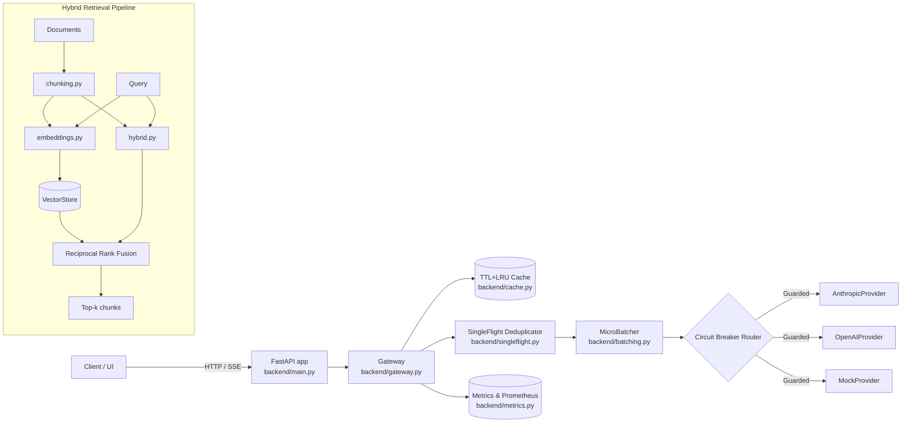

# AI Systems Lab

[](https://github.com/prathamkashyap/ai-systems-lab/actions/workflows/ci.yml)


A working lab and engineering reference for AI systems: a routed/cached/batched **inference
gateway** with **SingleFlight in-flight request deduplication**, **circuit breaker fault tolerance**, **SSE token streaming**,
a **hybrid retrieval pipeline** (BM25 + dense vector + Reciprocal Rank Fusion), a **RAG evaluation suite**,
reproducible **benchmarks**, and an **interactive web playground**.

The default development and test path runs completely offline with **zero API keys and zero network dependencies** using the built-in `MockProvider` and local TF-IDF embedding baseline. External model providers (Anthropic, OpenAI-compatible backends like Ollama/vLLM) activate seamlessly when environment variables or base URLs are configured.


## Why it's built this way

Most AI systems repositories are either single disconnected notebooks or empty scaffolding. This repository provides clean, real, tested engineering building blocks:

- **Inference Gateway**: Transparently applies **TTL+LRU caching**, **SingleFlight in-flight request deduplication** (eliminating cache stampedes under concurrency), **micro-batching**, **circuit breaking**, and **provider failover**.
- **Multi-Provider Ecosystem**: Uniform provider interface supporting **Anthropic Messages**, **OpenAI / OpenAI-compatible backends** (Ollama, vLLM, DeepSeek, Groq), and deterministic **MockProvider**.
- **Token Streaming**: Full async generator token streaming via Server-Sent Events (`/v1/completions/stream`).
- **Hybrid Retrieval Pipeline**: Chunks documents, indexes dense hashed TF-IDF vectors alongside a sparse **BM25 lexical index**, and fuses results via **Reciprocal Rank Fusion (RRF)**.
- **RAG Evaluation Suite**: Pluggable metrics for Context Precision (MRR), Context Recall, Keyword Coverage, and lexical Faithfulness/Groundedness.
- **Interactive Playground UI**: Zero-dependency web UI to test completions, stream tokens, run stress benchmarks, and inspect RAG retrievals.
- **Observability**: Real-time latency percentiles (p50, p95, p99), cache hit rates, deduplication rates, and a standard **Prometheus scrape endpoint** (`/metrics/prometheus`).

## Architecture



Detailed architectural records and sequence diagrams live in [`system-design/architecture.md`](system-design/architecture.md) and the [ADRs](system-design/adr/).

## Repository Structure

```text
ai-systems-lab/
├── backend/              # FastAPI gateway: routing, caching, batching, singleflight, circuit breakers
│   ├── static/           # Interactive Web UI Playground (zero external deps)
│   └── providers/        # Anthropic, OpenAI/Ollama/vLLM, and Mock implementations
├── ai/
│   ├── eval/             # RAG evaluation suite (precision, recall, faithfulness) + task harness
│   └── prompts/          # Versioned system prompt templates
├── data/                 # Hybrid chunking -> BM25 + Embed -> VectorStore -> RRF search pipeline
├── benchmarks/           # Latency/throughput harness + measured SingleFlight results
├── infrastructure/       # Dockerfile, docker-compose
├── system-design/        # Architecture diagrams + ADRs (0001-0005)
├── tests/                # 40-test pytest suite covering all components
└── examples/             # Runnable quickstart demonstrating gateway & RAG
```

## Quickstart

```bash
git clone https://github.com/prathamkashyap/ai-systems-lab.git
cd ai-systems-lab
pip install -e ".[dev]"

# 1. Run gateway and hybrid retrieval end to end (offline, zero API keys required)
python -m examples.quickstart

# 2. Run the test suite (40 unit and integration tests)
pytest -v

# 3. Run the benchmark harness (demonstrates SingleFlight stampede elimination)
python -m benchmarks.latency_bench

# 4. Start the interactive server & playground
uvicorn backend.main:app --reload
# -> Open http://localhost:8000 for the Interactive Playground UI
# -> Open http://localhost:8000/docs for Swagger OpenAPI docs
```

### Public mock-only playground mode

Set the application mode before starting the server:

```bash
AI_SYSTEMS_LAB_MODE=public-demo uvicorn backend.main:app --host 0.0.0.0 --port 8000 \
  --no-proxy-headers --timeout-graceful-shutdown 6

# The Compose service forwards the same setting into the container.
AI_SYSTEMS_LAB_MODE=public-demo UVICORN_PROXY_HEADERS=false \
  UVICORN_TIMEOUT_GRACEFUL_SHUTDOWN=6 \
  docker compose -f infrastructure/docker-compose.yml up --build
```

In `public-demo` mode the application constructs and registers **only MockProvider**.
Anthropic and OpenAI credentials and `OPENAI_BASE_URL` cannot activate external
inference providers, even if accidentally present. Completion, batch completion,
and streaming requests use mock output; `/health` lists only the mock provider.
Requests naming real models also produce explicitly labeled mock output; the
requested model name is preserved in the response. No real model is loaded or called.

Unset mode or `AI_SYSTEMS_LAB_MODE=developer` preserves the existing developer
configuration: Anthropic, OpenAI-compatible, then Mock providers, with the existing
model-selection rules. Any other value, including an empty string, fails startup.
Mode is read when `backend.main` is imported; restart the server to change it.
This setting controls the HTTP application's provider construction; independently
constructed `Gateway` instances remain configured by their caller.

For a future Render deployment, supply `AI_SYSTEMS_LAB_MODE=public-demo` as a
service environment variable before startup. The Docker image accepts this
variable at runtime. Keep real provider credentials out of public deployments.
This mode enforces mock-only inference, admission budgets, inference deadlines,
and the HTTP body and request-frequency policies below. Deployment remains separate work.

### Public-demo HTTP ingress

`AI_SYSTEMS_LAB_MAX_BODY_BYTES` defaults to **262144 bytes (256 KiB)** in public-demo
mode. Configure an ASCII decimal integer from **1 to 1048576 bytes (1 MiB)** before
startup. Empty, invalid, nonpositive, and larger values fail startup with a sanitized
configuration error. Developer mode ignores this variable and retains its existing
body handling and wildcard CORS behavior. Docker/Compose accept the same setting.

The default accommodates the playground, an 8,000-character UTF-8 prompt, a full
ASCII message collection, and a 16-member ASCII prompt batch. Bytes differ from
Pydantic's character limits: a model-valid batch can still exceed the aggregate
body budget, especially with multibyte text or JSON escaping. Split such requests
into smaller batches rather than assuming all field maxima fit together.

All public HTTP routes count actual ASGI body bytes before JSON/Pydantic parsing,
gateway admission, retrieval, or provider execution. Bodies exactly at the limit
remain eligible for normal validation. Oversized bodies return HTTP **413**:

```json
{"error":{"code":"request_too_large","message":"Request body too large"}}
```

A declared oversized `Content-Length` is rejected without reading the body.
Missing lengths and transfer-decoded chunked bodies are still counted. Underreported
lengths cannot bypass the byte budget. Malformed lengths, duplicate lengths (even
identical ones), combined `Content-Length`/`Transfer-Encoding`, and completed bodies
whose byte counts disagree with the declared length return HTTP **400**:
`{"error":{"code":"invalid_content_length","message":"Invalid Content-Length"}}`.
If actual bytes exceed the budget, 413 takes precedence over a length mismatch.
Decimal lengths may include surrounding spaces/tabs and leading zeros.
Server-level wire-framing errors occur before this middleware and use the HTTP
server's own response format.

The ASGI boundary buffers only an accepted body's configured byte budget, checking
each chunk before appending. It stops receiving at the first overflow and never
starts the application for a rejected body. This bounded pre-read also protects
GET routes that do not consume bodies themselves. A bounded copy is needed for
replay; the server's already-received chunk and downstream parsing allocations are
separate. No reader tasks are spawned, and the original disconnect channel remains
available to SSE after the accepted body is replayed.

The public playground uses same-origin URLs, so public mode grants **no cross-origin
CORS permissions**. Rate-admitted cross-origin preflights receive 405 and responses have no
`Access-Control-Allow-Origin` or credential permission headers. Same-origin HTTP
and SSE continue normally. CORS controls browser response access; it is not
authentication and does not prevent direct HTTP clients from calling the API.

This is a per-request body bound, not a total process-memory or connection budget.
Upload deadlines, aggregate ingress concurrency, and header limits are not supplied
by the body middleware. Request frequency is handled separately below. HTTP wire framing is handled by the
ASGI server. Keep the demo undeployed until the remaining public-safety gates are
complete. See [ADR 0008](system-design/adr/0008-public-http-ingress.md).

### Public-demo request-rate limits

| Startup environment variable | Default | Allowed range |
|---|---:|---|
| `AI_SYSTEMS_LAB_RATE_BURST` | 60 requests | Integer 1–120 |
| `AI_SYSTEMS_LAB_RATE_REFILL_PER_S` | 2 tokens/second | Finite number 0.01–10 |
| `AI_SYSTEMS_LAB_RATE_MAX_CLIENTS` | 1024 buckets | Integer 1–4096 |

Invalid/empty settings fail public startup without echoing values. Developer mode
ignores these settings and installs no rate limiter. Each process has its own
single-event-loop token buckets, using monotonic time; workers and instances do
not share limits. This is application throttling, not distributed quotas or an
anti-DDoS guarantee.

Every HTTP request costs one token, except **exact `GET /health`**. This includes
completions, SSE, retrieval, metrics, the playground/docs, preflights, unknown paths,
cache hits, and SingleFlight joiners. A batch costs one HTTP token, not one token
per member; existing batch-size and inference-admission limits still account for
its downstream work. The playground benchmark submits 50 HTTP requests and costs
50 tokens; the default permits one such burst with room for ordinary interactions.
Rapid repeats may be throttled. No automatic retry loops are introduced.

Rate admission runs before body reading, then the body limit, model validation,
and execution admission. A rate-admitted request still costs its token if it later
receives 400/413/422/503/504 or disconnects. Existing accepted work is never evicted
or cancelled by the rate limiter. `GET /health` remains protected by the body limit
and only checks public MockProvider health; it cannot run inference or retrieval.

Exhaustion returns HTTP **429**, including before headers on rejected SSE requests:
`{"error":{"code":"rate_limited","message":"Too many requests"}}`.
For a depleted known bucket, `Retry-After` is the positive integer ceiling of time
needed to refill one token. It is an earliest-availability hint; competing requests
can consume that token. Registry-capacity and unsafe-identity rejections omit the
header because no reliable retry time is known. Rejections read no body, parse no
JSON, and do not register inference work or update inference success/error metrics.

Buckets use canonical IP bytes, ignoring source ports; equivalent IPv6 forms and
IPv4-mapped IPv6 addresses share quotas. Missing/malformed identities share one
fallback bucket within the same registry cap. Fixed-size keys and a bounded
ordered registry prevent identity-state growth. Entries are reclaimed only when
fully replenished and idle for `max(60 seconds, burst/refill)`. Active clients are
never evicted to make room. If no safe slot exists, a new identity receives 429.
Checks are synchronous within one event loop, without locks, waiters, or tasks.

**Client identity and proxy policy:** run the public uvicorn CLI with
`--no-proxy-headers` (or `UVICORN_PROXY_HEADERS=false`). The application never uses
forwarding-header values to choose buckets. Installed uvicorn can rewrite the ASGI
client from `X-Forwarded-For` when proxy-header processing is enabled. Its rewritten
form `(forwarded_host, 0)` plus that header is rejected conservatively with 429;
the actual peer cannot be recovered at the application layer. This safeguard is
specific to the inspected uvicorn behavior, not a proxy-trust framework.

```bash
AI_SYSTEMS_LAB_MODE=public-demo uvicorn backend.main:app \
  --no-proxy-headers --timeout-graceful-shutdown 6
```

Programmatic servers must pass `proxy_headers=False` explicitly; the uvicorn CLI
environment option is not an application-mode switch. Behind Render, another proxy,
or NAT, users may share a connection-peer bucket. Verify actual trusted-address
behavior before claiming per-user or end-client-IP fairness. Disabling proxy headers
also affects forwarded scheme handling, so external URL/redirect behavior needs
deployment verification. Do not enable wildcard forwarded-header trust to obtain
apparent per-user quotas. See [ADR 0009](system-design/adr/0009-public-request-rate-limits.md).

### Public-demo admission budgets

These per-process settings are read at application startup and forwarded by Compose:

| Environment variable | Default | Meaning |
|---|---|---|
| `AI_SYSTEMS_LAB_MAX_ACTIVE` | 4 | Maximum active downstream work reservations; positive integer |
| `AI_SYSTEMS_LAB_MAX_PENDING` | 16 | Maximum pending completion work items; nonnegative integer |
| `AI_SYSTEMS_LAB_MAX_REQUESTS` | 64 | Maximum concurrent inference request waiters, including duplicate joins and streams; positive integer |

Public mode admits at most `MAX_ACTIVE + MAX_PENDING` unique downstream work
items. Four active reservations and sixteen pending items conservatively bound
a small demonstration; these defaults are not a measured hosting-capacity claim.
Invalid or empty limit values fail startup without echoing their values. Developer
mode ignores these settings and preserves its existing unbounded behavior.

Admission occurs after validation and cache inspection, before new SingleFlight
workers or micro-batcher submissions are started. Cache hits use no downstream
reservation. Existing SingleFlight joins share a flight's reservation, but each
HTTP request still consumes one waiter slot. An explicit HTTP batch uses one
waiter slot and atomically reserves the new work its members represent: cached
members and existing/duplicate flights need no additional execution reservations.
If the group cannot fit, no new member starts and no join is registered.

An active completion reservation covers micro-batcher waiting and batch-wide
result delivery as well as actual provider execution. Multiple flushes may still
run concurrently, but total active work stays bounded. Flush size is not queue
capacity, and grouping still makes individual provider calls. Pending items wait
in a bounded FIFO; there is no unbounded semaphore waiting population.

Streams do not queue: they need an active reservation before SSE headers are sent
and hold it through response completion, error, or disconnect, including pauses
between chunks. Overload never evicts an accepted stream. Cancelling a completion
caller releases its waiter slot, but its accepted independent work continues and
keeps its execution reservation until finished. Shutdown stops admission, closes
streams, and drains accepted completion flights before closing the batcher, within
the deadline and cancellation policy below.

Overload returns HTTP **503** with JSON
`{"error":{"code":"capacity_unavailable","message":"Public demo is busy"}}`.
Saturated streams receive that response before SSE begins. Rejected work does not
call providers, update cache hit/miss counters, or count as provider failure or
successful execution. No `Retry-After` time is guessed: availability depends on
work completion, and clients should not run automatic retry loops.

These limits cover inference work inside one application process, not socket
connections, request parsing/body buffering, retrieval, or aggregate multi-worker
capacity. Keep the public demo undeployed until the remaining public-safety gates
are complete. See [ADR 0006](system-design/adr/0006-public-demo-admission.md).

### Public-demo deadlines and shutdown

| Environment variable | Default | Meaning |
|---|---|---|
| `AI_SYSTEMS_LAB_WORK_TIMEOUT_S` | 10 seconds | Lifetime of newly admitted work, including pending and micro-batcher residence |
| `AI_SYSTEMS_LAB_STREAM_TIMEOUT_S` | 15 seconds | Total stream lifetime from reservation, including response sending |
| `AI_SYSTEMS_LAB_SHUTDOWN_GRACE_S` | 5 seconds | Application drain grace after admission stops |
| `AI_SYSTEMS_LAB_CANCEL_GRACE_S` | 1 second | Bounded observation of cancellation cleanup |

Durations must be finite and positive. Developer mode ignores these settings;
its existing inference and application-close behavior remains unchanged. Work
deadlines use the event loop's monotonic clock. Joiners inherit the existing
flight's deadline; joining or cancelling a caller cannot reset or cancel it.

A normal request exceeding its work deadline returns HTTP **504**:
`{"error":{"code":"inference_deadline_exceeded","message":"Inference deadline exceeded"}}`.
Before stream headers the same error is HTTP 504. After headers, a timeout sends
one terminal SSE `event: error` with that JSON in `data`, then closes without
`[DONE]`. A disconnected or unresponsive client may not receive the terminal event.

Queued expiry removes the item without provider execution. Expiry of any member
of an executing flush cancels the entire flush, errors unresolved member futures,
and prevents later sequential calls in that flush. Results from an expired flush
are not cached or recorded as successes. This preserves batch-wide failure semantics.

**A timeout response does not itself release execution capacity.** The actual
batch task owns release after provider execution ends. Stream cleanup has the
same ownership rule. If a provider takes time to unwind cancellation, its slot
remains occupied. If it exceeds the cancellation grace, the process fails admission
closed, retains unfinished execution reservations, and requires operator restart.

Shutdown stops admission immediately, terminates streams, and drains completion
work for the configured grace. At grace expiry it errors pending work and signals
running flushes to cancel, then observes cleanup for the cancellation grace.
Cooperative cleanup returns work/request counters to zero. Incomplete cleanup
raises a sanitized shutdown error; it does not claim the provider stopped. Concurrent
close callers share one shielded shutdown operation, so cancelling a close waiter
does not abandon that operation.

**Public process-stop policy:** run uvicorn with
`--timeout-graceful-shutdown 6` (or `UVICORN_TIMEOUT_GRACEFUL_SHUTDOWN=6`) and
configure the container/supervisor to send SIGKILL after 15 seconds from SIGTERM.
With defaults, the budget is 6 seconds server request drain + 5 seconds application
drain + 1 second cancellation cleanup, with remaining supervisor margin. Compose
forwards the optional uvicorn setting and uses `stop_grace_period: 15s`; for the
public profile start it with:

```bash
AI_SYSTEMS_LAB_MODE=public-demo UVICORN_TIMEOUT_GRACEFUL_SHUTDOWN=6 \
  UVICORN_PROXY_HEADERS=false \
  docker compose -f infrastructure/docker-compose.yml up --build
```

If durations are increased, increase the supervisor stop budget accordingly.
Cancellation-resistant code or a blocked event loop cannot be killed safely by
an asyncio timeout. The host supervisor must enforce process termination; an
application error or restart policy alone is insufficient. The Compose stop grace
also applies in developer mode, but its uvicorn setting remains opt-in. This is
not a deployment: the future hosting task must verify the platform's hard-stop
behavior before exposing the demo. Uvicorn drains HTTP tasks before application
shutdown; expiry of its own request-drain limit can interrupt a response (including
HTTP 500), even though the application subsequently cleans up owned provider work.
The 504/SSE contract describes inference deadlines while the response is still
available. See [ADR 0007](system-design/adr/0007-public-demo-deadlines.md).

### With Real Model Providers

Set environment variables and the gateway automatically routes matching requests to live APIs:

```bash
# Anthropic
export ANTHROPIC_API_KEY=sk-ant-...
curl -X POST localhost:8000/v1/completions \
  -H "content-type: application/json" \
  -d '{"prompt": "Explain micro-batching in one sentence.", "model": "claude-sonnet-4-6"}'

# OpenAI / Compatible API
export OPENAI_API_KEY=sk-...
curl -X POST localhost:8000/v1/completions \
  -H "content-type: application/json" \
  -d '{"prompt": "Explain RRF ranking.", "model": "gpt-4o-mini"}'

# Local Ollama or vLLM
export OPENAI_BASE_URL=http://localhost:11434/v1
curl -X POST localhost:8000/v1/completions \
  -H "content-type: application/json" \
  -d '{"prompt": "Hello from local model", "model": "llama-3.3-70b"}'
```

### With Docker

```bash
docker compose -f infrastructure/docker-compose.yml up --build
```

## API Surface

| Endpoint | Method | Description |
|---|---|---|
| `/` or `/playground` | GET | Interactive AI Systems Lab Web UI |
| `/v1/completions` | POST | Single completion (routed, cached, deduplicated, batched) |
| `/v1/completions/stream` | POST | Streaming tokens via Server-Sent Events (SSE) |
| `/v1/completions/batch` | POST | Explicit batch of concurrent completions |
| `/v1/rag/search` | GET | Hybrid (RRF), Dense Vector, or BM25 Lexical search |
| `/health` | GET | Liveness, per-provider health, and circuit breaker status |
| `/metrics` | GET | JSON latency percentiles, hit rates, and dedup stats |
| `/metrics/prometheus` | GET | Prometheus text exposition scrape format |
| `/docs` | GET | Interactive OpenAPI documentation |

### API input validation

These limits apply in both `developer` and `public-demo` modes:

| Input | Accepted boundary |
|---|---|
| Completion prompt | Non-whitespace text, at most 8,000 characters |
| Message content | Non-whitespace text, at most 8,000 characters per message |
| Message collection | 1–32 messages, using the existing system/user/assistant roles |
| Explicit HTTP batch | 1–16 valid completion requests |
| Retrieval query | Non-whitespace text, at most 2,000 characters |
| Retrieval `top_k` | Integer from 1 to 20, default 5 |
| Retrieval mode | `hybrid`, `vector`, or `bm25` |

Supply exactly one non-null `prompt` or `messages` input. Supplying both is
rejected rather than silently choosing one. Empty message lists are rejected;
an unused input may be omitted or explicitly `null`. Valid text is preserved
without trimming. Lengths count characters, not bytes or model tokens.

Pydantic validates completions, messages, and every explicit batch member before
the endpoint runs. FastAPI validates retrieval parameters before search. Invalid
requests that pass HTTP ingress return HTTP 422, including on the streaming endpoint before SSE starts.
One invalid batch member rejects the entire HTTP batch without executing any of
its members. Direct construction of these Pydantic request models also validates
their inputs. Success response schemas and generation-parameter bounds are unchanged.

The limits accommodate the quickstart and playground while bounding individual
application inputs. The explicit HTTP batch limit is separate from micro-batcher
queue capacity and the public HTTP body-byte budget. Public-demo admission and
deadline and HTTP request-rate policies are described above. Direct use of the
retrieval library is not governed by HTTP query constraints.

## Benchmark Summary

> [!NOTE]
> Below are observed illustrative measurements on Apple Silicon (M-series). Re-run locally to reproduce on your hardware: `python -m benchmarks.latency_bench`.

| Scenario | n | Wall Time (ms) | Throughput (req/s) | p50 (ms) | p95 (ms) | Dedup / Hit Rate |
|---|---|---|---|---|---|---|
| Baseline (unique prompts, no cache) | 200 | 297.7 | 671.9 | 282.5 | 296.4 | 0.0% |
| **200 Concurrent Duplicate Prompts (SingleFlight)** | 200 | **45.5** | **4,397.1** | **41.3** | **41.8** | **99.5% (1 provider call)** |
| Wide Batch Window (50ms) | 200 | 1166.5 | 171.5 | 1164.0 | 1164.3 | 0.0% (4 batches) |
| Sequential Repeated Prompts | 200 | 37.9 | 5,277.9 | 0.03 | 0.05 | 99.5% |

See [`benchmarks/results/README.md`](benchmarks/results/README.md) for detailed architectural analysis.


## License

MIT — see [LICENSE](LICENSE).
