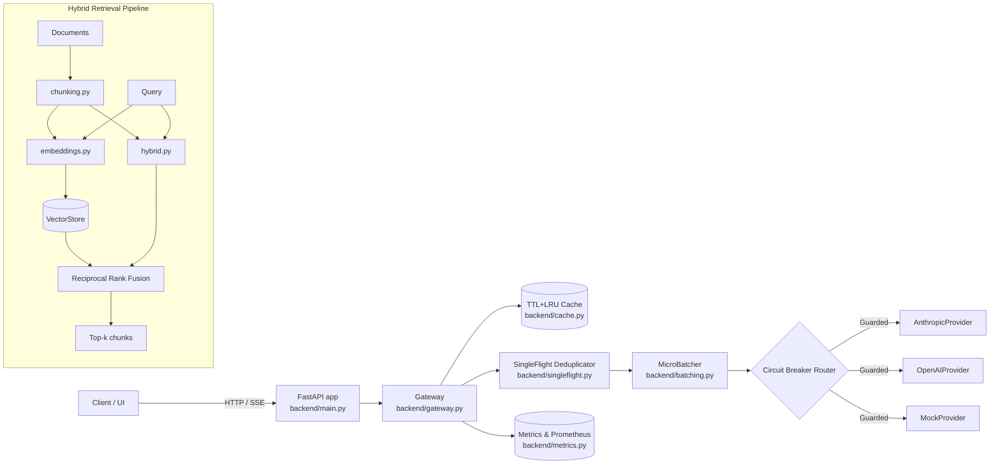

# AI Systems Lab

[](https://github.com/prathamkashyap/ai-systems-lab/actions/workflows/ci.yml)


A working lab and engineering reference for AI systems: a routed/cached/batched **inference
gateway** with **SingleFlight in-flight request deduplication**, **circuit breaker fault tolerance**, **SSE token streaming**,
a **hybrid retrieval pipeline** (BM25 + dense vector + Reciprocal Rank Fusion), a **RAG evaluation suite**,
reproducible **benchmarks**, and an **interactive web playground**.

The default development and test path runs completely offline with **zero API keys and zero network dependencies** using the built-in `MockProvider` and local TF-IDF embedding baseline. External model providers (Anthropic, OpenAI-compatible backends like Ollama/vLLM) activate seamlessly when environment variables or base URLs are configured.


## Why it's built this way

Most AI systems repositories are either single disconnected notebooks or empty scaffolding. This repository provides clean, real, tested engineering building blocks:

- **Inference Gateway**: Transparently applies **TTL+LRU caching**, **SingleFlight in-flight request deduplication** (eliminating cache stampedes under concurrency), **micro-batching**, **circuit breaking**, and **provider failover**.
- **Multi-Provider Ecosystem**: Uniform provider interface supporting **Anthropic Messages**, **OpenAI / OpenAI-compatible backends** (Ollama, vLLM, DeepSeek, Groq), and deterministic **MockProvider**.
- **Token Streaming**: Full async generator token streaming via Server-Sent Events (`/v1/completions/stream`).
- **Hybrid Retrieval Pipeline**: Chunks documents, indexes dense hashed TF-IDF vectors alongside a sparse **BM25 lexical index**, and fuses results via **Reciprocal Rank Fusion (RRF)**.
- **RAG Evaluation Suite**: Pluggable metrics for Context Precision (MRR), Context Recall, Keyword Coverage, and lexical Faithfulness/Groundedness.
- **Interactive Playground UI**: Zero-dependency web UI to test completions, stream tokens, run stress benchmarks, and inspect RAG retrievals.
- **Observability**: Real-time latency percentiles (p50, p95, p99), cache hit rates, deduplication rates, and a standard **Prometheus scrape endpoint** (`/metrics/prometheus`).

## Architecture



Detailed architectural records and sequence diagrams live in [`system-design/architecture.md`](system-design/architecture.md) and the [ADRs](system-design/adr/).

## Repository Structure

```text
ai-systems-lab/
├── backend/              # FastAPI gateway: routing, caching, batching, singleflight, circuit breakers
│   ├── static/           # Interactive Web UI Playground (zero external deps)
│   └── providers/        # Anthropic, OpenAI/Ollama/vLLM, and Mock implementations
├── ai/
│   ├── eval/             # RAG evaluation suite (precision, recall, faithfulness) + task harness
│   └── prompts/          # Versioned system prompt templates
├── data/                 # Hybrid chunking -> BM25 + Embed -> VectorStore -> RRF search pipeline
├── benchmarks/           # Latency/throughput harness + measured SingleFlight results
├── infrastructure/       # Dockerfile, docker-compose
├── system-design/        # Architecture diagrams + ADRs (0001-0005)
├── tests/                # 40-test pytest suite covering all components
└── examples/             # Runnable quickstart demonstrating gateway & RAG
```

## Quickstart

```bash
git clone https://github.com/prathamkashyap/ai-systems-lab.git
cd ai-systems-lab
pip install -e ".[dev]"

# 1. Run gateway and hybrid retrieval end to end (offline, zero API keys required)
python -m examples.quickstart

# 2. Run the test suite (40 unit and integration tests)
pytest -v

# 3. Run the benchmark harness (demonstrates SingleFlight stampede elimination)
python -m benchmarks.latency_bench

# 4. Start the interactive server & playground
uvicorn backend.main:app --reload
# -> Open http://localhost:8000 for the Interactive Playground UI
# -> Open http://localhost:8000/docs for Swagger OpenAPI docs
```

### Public mock-only playground mode

Set the application mode before starting the server:

```bash
AI_SYSTEMS_LAB_MODE=public-demo uvicorn backend.main:app --host 0.0.0.0 --port 8000

# The Compose service forwards the same setting into the container.
AI_SYSTEMS_LAB_MODE=public-demo docker compose -f infrastructure/docker-compose.yml up --build
```

In `public-demo` mode the application constructs and registers **only MockProvider**.
Anthropic and OpenAI credentials and `OPENAI_BASE_URL` cannot activate external
inference providers, even if accidentally present. Completion, batch completion,
and streaming requests use mock output; `/health` lists only the mock provider.
Requests naming real models also produce explicitly labeled mock output; the
requested model name is preserved in the response. No real model is loaded or called.

Unset mode or `AI_SYSTEMS_LAB_MODE=developer` preserves the existing developer
configuration: Anthropic, OpenAI-compatible, then Mock providers, with the existing
model-selection rules. Any other value, including an empty string, fails startup.
Mode is read when `backend.main` is imported; restart the server to change it.
This setting controls the HTTP application's provider construction; independently
constructed `Gateway` instances remain configured by their caller.

For a future Render deployment, supply `AI_SYSTEMS_LAB_MODE=public-demo` as a
service environment variable before startup. The Docker image accepts this
variable at runtime. Keep real provider credentials out of public deployments.
This mode enforces mock-only inference and the admission budgets below. Global
body limits, deadlines, rate limiting, and deployment remain separate work.

### Public-demo admission budgets

These per-process settings are read at application startup and forwarded by Compose:

| Environment variable | Default | Meaning |
|---|---|---|
| `AI_SYSTEMS_LAB_MAX_ACTIVE` | 4 | Maximum active downstream work reservations; positive integer |
| `AI_SYSTEMS_LAB_MAX_PENDING` | 16 | Maximum pending completion work items; nonnegative integer |
| `AI_SYSTEMS_LAB_MAX_REQUESTS` | 64 | Maximum concurrent inference request waiters, including duplicate joins and streams; positive integer |

Public mode admits at most `MAX_ACTIVE + MAX_PENDING` unique downstream work
items. Four active reservations and sixteen pending items conservatively bound
a small demonstration; these defaults are not a measured hosting-capacity claim.
Invalid or empty limit values fail startup without echoing their values. Developer
mode ignores these settings and preserves its existing unbounded behavior.

Admission occurs after validation and cache inspection, before new SingleFlight
workers or micro-batcher submissions are started. Cache hits use no downstream
reservation. Existing SingleFlight joins share a flight's reservation, but each
HTTP request still consumes one waiter slot. An explicit HTTP batch uses one
waiter slot and atomically reserves the new work its members represent: cached
members and existing/duplicate flights need no additional execution reservations.
If the group cannot fit, no new member starts and no join is registered.

An active completion reservation covers micro-batcher waiting and batch-wide
result delivery as well as actual provider execution. Multiple flushes may still
run concurrently, but total active work stays bounded. Flush size is not queue
capacity, and grouping still makes individual provider calls. Pending items wait
in a bounded FIFO; there is no unbounded semaphore waiting population.

Streams do not queue: they need an active reservation before SSE headers are sent
and hold it through response completion, error, or disconnect, including pauses
between chunks. Overload never evicts an accepted stream. Cancelling a completion
caller releases its waiter slot, but its accepted independent work continues and
keeps its execution reservation until finished. Shutdown stops admission, closes
streams, and drains accepted completion flights before closing the batcher. Without
deadlines, a stalled operation can still occupy its bounded slot indefinitely.

Overload returns HTTP **503** with JSON
`{"error":{"code":"capacity_unavailable","message":"Public demo is busy"}}`.
Saturated streams receive that response before SSE begins. Rejected work does not
call providers, update cache hit/miss counters, or count as provider failure or
successful execution. No `Retry-After` time is guessed: availability depends on
work completion, and clients should not run automatic retry loops.

These limits cover inference work inside one application process, not socket
connections, request parsing/body buffering, retrieval, or aggregate multi-worker
capacity. Keep the public demo undeployed until the remaining public-safety gates
are complete. See [ADR 0006](system-design/adr/0006-public-demo-admission.md).

### With Real Model Providers

Set environment variables and the gateway automatically routes matching requests to live APIs:

```bash
# Anthropic
export ANTHROPIC_API_KEY=sk-ant-...
curl -X POST localhost:8000/v1/completions \
  -H "content-type: application/json" \
  -d '{"prompt": "Explain micro-batching in one sentence.", "model": "claude-sonnet-4-6"}'

# OpenAI / Compatible API
export OPENAI_API_KEY=sk-...
curl -X POST localhost:8000/v1/completions \
  -H "content-type: application/json" \
  -d '{"prompt": "Explain RRF ranking.", "model": "gpt-4o-mini"}'

# Local Ollama or vLLM
export OPENAI_BASE_URL=http://localhost:11434/v1
curl -X POST localhost:8000/v1/completions \
  -H "content-type: application/json" \
  -d '{"prompt": "Hello from local model", "model": "llama-3.3-70b"}'
```

### With Docker

```bash
docker compose -f infrastructure/docker-compose.yml up --build
```

## API Surface

| Endpoint | Method | Description |
|---|---|---|
| `/` or `/playground` | GET | Interactive AI Systems Lab Web UI |
| `/v1/completions` | POST | Single completion (routed, cached, deduplicated, batched) |
| `/v1/completions/stream` | POST | Streaming tokens via Server-Sent Events (SSE) |
| `/v1/completions/batch` | POST | Explicit batch of concurrent completions |
| `/v1/rag/search` | GET | Hybrid (RRF), Dense Vector, or BM25 Lexical search |
| `/health` | GET | Liveness, per-provider health, and circuit breaker status |
| `/metrics` | GET | JSON latency percentiles, hit rates, and dedup stats |
| `/metrics/prometheus` | GET | Prometheus text exposition scrape format |
| `/docs` | GET | Interactive OpenAPI documentation |

### API input validation

These limits apply in both `developer` and `public-demo` modes:

| Input | Accepted boundary |
|---|---|
| Completion prompt | Non-whitespace text, at most 8,000 characters |
| Message content | Non-whitespace text, at most 8,000 characters per message |
| Message collection | 1–32 messages, using the existing system/user/assistant roles |
| Explicit HTTP batch | 1–16 valid completion requests |
| Retrieval query | Non-whitespace text, at most 2,000 characters |
| Retrieval `top_k` | Integer from 1 to 20, default 5 |
| Retrieval mode | `hybrid`, `vector`, or `bm25` |

Supply exactly one non-null `prompt` or `messages` input. Supplying both is
rejected rather than silently choosing one. Empty message lists are rejected;
an unused input may be omitted or explicitly `null`. Valid text is preserved
without trimming. Lengths count characters, not bytes or model tokens.

Pydantic validates completions, messages, and every explicit batch member before
the endpoint runs. FastAPI validates retrieval parameters before search. Invalid
requests return HTTP 422, including on the streaming endpoint before SSE starts.
One invalid batch member rejects the entire HTTP batch without executing any of
its members. Direct construction of these Pydantic request models also validates
their inputs. Success response schemas and generation-parameter bounds are unchanged.

The limits accommodate the quickstart and playground while bounding individual
application inputs. The explicit HTTP batch limit is separate from micro-batcher
queue capacity. Global body limits, concurrent execution/admission, queue bounds,
deadlines, and per-client rate limiting remain separate work. Direct use of the
retrieval library is not governed by the HTTP query constraints.

## Benchmark Summary

> [!NOTE]
> Below are observed illustrative measurements on Apple Silicon (M-series). Re-run locally to reproduce on your hardware: `python -m benchmarks.latency_bench`.

| Scenario | n | Wall Time (ms) | Throughput (req/s) | p50 (ms) | p95 (ms) | Dedup / Hit Rate |
|---|---|---|---|---|---|---|
| Baseline (unique prompts, no cache) | 200 | 297.7 | 671.9 | 282.5 | 296.4 | 0.0% |
| **200 Concurrent Duplicate Prompts (SingleFlight)** | 200 | **45.5** | **4,397.1** | **41.3** | **41.8** | **99.5% (1 provider call)** |
| Wide Batch Window (50ms) | 200 | 1166.5 | 171.5 | 1164.0 | 1164.3 | 0.0% (4 batches) |
| Sequential Repeated Prompts | 200 | 37.9 | 5,277.9 | 0.03 | 0.05 | 99.5% |

See [`benchmarks/results/README.md`](benchmarks/results/README.md) for detailed architectural analysis.


## License

MIT — see [LICENSE](LICENSE).
