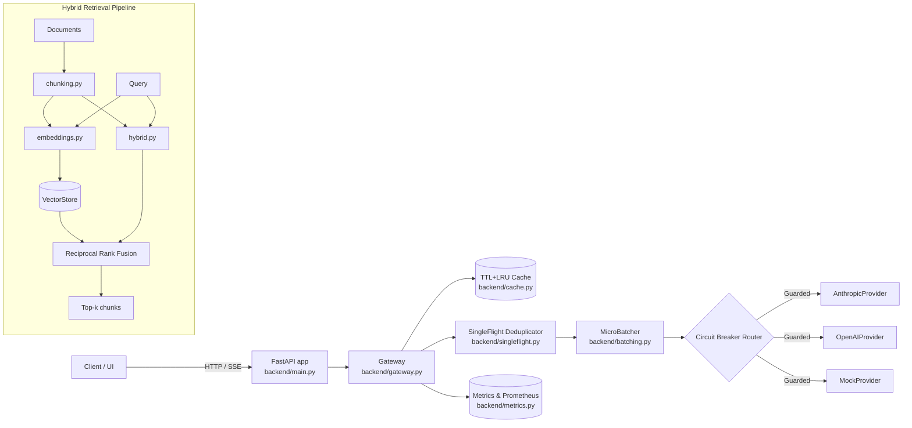

# AI Systems Lab

[](https://github.com/prathamkashyap/ai-systems-lab/actions/workflows/ci.yml)


A working lab and engineering reference for AI systems: a routed/cached/batched **inference
gateway** with **SingleFlight in-flight request deduplication**, **circuit breaker fault tolerance**, **SSE token streaming**,
a **hybrid retrieval pipeline** (BM25 + dense vector + Reciprocal Rank Fusion), a **RAG evaluation suite**,
reproducible **benchmarks**, and an **interactive web playground**.

The default development and test path runs completely offline with **zero API keys and zero network dependencies** using the built-in `MockProvider` and local TF-IDF embedding baseline. External model providers (Anthropic, OpenAI-compatible backends like Ollama/vLLM) activate seamlessly when environment variables or base URLs are configured.


## Why it's built this way

Most AI systems repositories are either single disconnected notebooks or empty scaffolding. This repository provides clean, real, tested engineering building blocks:

- **Inference Gateway**: Transparently applies **TTL+LRU caching**, **SingleFlight in-flight request deduplication** (eliminating cache stampedes under concurrency), **micro-batching**, **circuit breaking**, and **provider failover**.
- **Multi-Provider Ecosystem**: Uniform provider interface supporting **Anthropic Messages**, **OpenAI / OpenAI-compatible backends** (Ollama, vLLM, DeepSeek, Groq), and deterministic **MockProvider**.
- **Token Streaming**: Full async generator token streaming via Server-Sent Events (`/v1/completions/stream`).
- **Hybrid Retrieval Pipeline**: Chunks documents, indexes dense hashed TF-IDF vectors alongside a sparse **BM25 lexical index**, and fuses results via **Reciprocal Rank Fusion (RRF)**.
- **RAG Evaluation Suite**: Pluggable metrics for Context Precision (MRR), Context Recall, Keyword Coverage, and lexical Faithfulness/Groundedness.
- **Interactive Playground UI**: Zero-dependency web UI to test completions, stream tokens, run stress benchmarks, and inspect RAG retrievals.
- **Observability**: Real-time latency percentiles (p50, p95, p99), cache hit rates, deduplication rates, and a standard **Prometheus scrape endpoint** (`/metrics/prometheus`).

## Architecture



Detailed architectural records and sequence diagrams live in [`system-design/architecture.md`](system-design/architecture.md) and the [ADRs](system-design/adr/).

## Repository Structure

```text
ai-systems-lab/
├── backend/              # FastAPI gateway: routing, caching, batching, singleflight, circuit breakers
│   ├── static/           # Interactive Web UI Playground (zero external deps)
│   └── providers/        # Anthropic, OpenAI/Ollama/vLLM, and Mock implementations
├── ai/
│   ├── eval/             # RAG evaluation suite (precision, recall, faithfulness) + task harness
│   └── prompts/          # Versioned system prompt templates
├── data/                 # Hybrid chunking -> BM25 + Embed -> VectorStore -> RRF search pipeline
├── benchmarks/           # Latency/throughput harness + measured SingleFlight results
├── infrastructure/       # Dockerfile, docker-compose
├── system-design/        # Architecture diagrams + ADRs (0001-0005)
├── tests/                # 40-test pytest suite covering all components
└── examples/             # Runnable quickstart demonstrating gateway & RAG
```

## Quickstart

```bash
git clone https://github.com/prathamkashyap/ai-systems-lab.git
cd ai-systems-lab
pip install -e ".[dev]"

# 1. Run gateway and hybrid retrieval end to end (offline, zero API keys required)
python -m examples.quickstart

# 2. Run the test suite (40 unit and integration tests)
pytest -v

# 3. Run the benchmark harness (demonstrates SingleFlight stampede elimination)
python -m benchmarks.latency_bench

# 4. Start the interactive server & playground
uvicorn backend.main:app --reload
# -> Open http://localhost:8000 for the Interactive Playground UI
# -> Open http://localhost:8000/docs for Swagger OpenAPI docs
```

### With Real Model Providers

Set environment variables and the gateway automatically routes matching requests to live APIs:

```bash
# Anthropic
export ANTHROPIC_API_KEY=sk-ant-...
curl -X POST localhost:8000/v1/completions \
  -H "content-type: application/json" \
  -d '{"prompt": "Explain micro-batching in one sentence.", "model": "claude-sonnet-4-6"}'

# OpenAI / Compatible API
export OPENAI_API_KEY=sk-...
curl -X POST localhost:8000/v1/completions \
  -H "content-type: application/json" \
  -d '{"prompt": "Explain RRF ranking.", "model": "gpt-4o-mini"}'

# Local Ollama or vLLM
export OPENAI_BASE_URL=http://localhost:11434/v1
curl -X POST localhost:8000/v1/completions \
  -H "content-type: application/json" \
  -d '{"prompt": "Hello from local model", "model": "llama-3.3-70b"}'
```

### With Docker

```bash
docker compose -f infrastructure/docker-compose.yml up --build
```

## API Surface

| Endpoint | Method | Description |
|---|---|---|
| `/` or `/playground` | GET | Interactive AI Systems Lab Web UI |
| `/v1/completions` | POST | Single completion (routed, cached, deduplicated, batched) |
| `/v1/completions/stream` | POST | Streaming tokens via Server-Sent Events (SSE) |
| `/v1/completions/batch` | POST | Explicit batch of concurrent completions |
| `/v1/rag/search` | GET | Hybrid (RRF), Dense Vector, or BM25 Lexical search |
| `/health` | GET | Liveness, per-provider health, and circuit breaker status |
| `/metrics` | GET | JSON latency percentiles, hit rates, and dedup stats |
| `/metrics/prometheus` | GET | Prometheus text exposition scrape format |
| `/docs` | GET | Interactive OpenAPI documentation |

## Benchmark Summary

> [!NOTE]
> Below are observed illustrative measurements on Apple Silicon (M-series). Re-run locally to reproduce on your hardware: `python -m benchmarks.latency_bench`.

| Scenario | n | Wall Time (ms) | Throughput (req/s) | p50 (ms) | p95 (ms) | Dedup / Hit Rate |
|---|---|---|---|---|---|---|
| Baseline (unique prompts, no cache) | 200 | 297.7 | 671.9 | 282.5 | 296.4 | 0.0% |
| **200 Concurrent Duplicate Prompts (SingleFlight)** | 200 | **45.5** | **4,397.1** | **41.3** | **41.8** | **99.5% (1 provider call)** |
| Wide Batch Window (50ms) | 200 | 1166.5 | 171.5 | 1164.0 | 1164.3 | 0.0% (4 batches) |
| Sequential Repeated Prompts | 200 | 37.9 | 5,277.9 | 0.03 | 0.05 | 99.5% |

See [`benchmarks/results/README.md`](benchmarks/results/README.md) for detailed architectural analysis.


## License

MIT — see [LICENSE](LICENSE).
